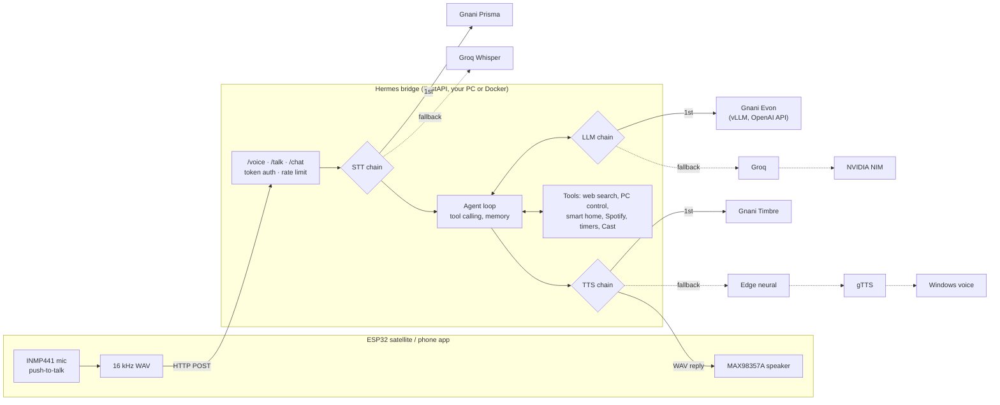

# Hermes — a DIY voice AI agent for your home


[](https://github.com/ROHITCRAFTSYT/Hermes/actions/workflows/ci.yml)

Hermes turns a **₹1,500 ESP32** into a hands‑held voice assistant that runs on
your own PC. Hold the button, talk (in **English or Tamil**), and it answers out
loud — and unlike a closed smart speaker, it can **open apps and websites, search
the web, control your PC and media, run smart‑home devices, control other
computers on your network, cast to TVs, and remember your conversation.**

The clever part: the ESP32 is just the *ears and mouth*. All the intelligence
runs in a small Python "brain" on a PC you already own, so the hardware stays
cheap and the AI stays as powerful as you like.



Each stage is a chain. `STT_PROVIDER`, `LLM_PROVIDER` and `TTS_PROVIDER` pick the first
link. A provider with no key is skipped, and if one fails at runtime (timeout, 5xx, rate
limit, bad key) the next one answers, so a dead API never leaves the ESP32 hanging.
The diagram shows the Gnani-first setup used for the demo. The default is Groq first.

> Built and documented as an open maker project. Total build cost **≈ ₹1,500–3,000**;
> the brain runs on a PC you already have.

---

## ✨ Features

- 🎙️ **Push‑to‑talk voice** — press the ESP32's button, speak, release.
- 🌐 **Real web agent** — searches the web and *speaks the answer*; opens
  websites and YouTube in your browser ("surf" mode).
- 🖥️ **PC & media control** — open/close apps, switch windows, play/pause,
  volume, screenshots, lock the PC.
- 🎵 **Spotify** — "play Over My Dead Body" plays that exact song (Premium, one‑time login).
- ⏰ **Timers, reminders & alarms** — "set a pasta timer for 8 minutes", "remind me at
  6 pm to call mom", "wake me up at 7 every day". A chime plus a spoken message on the
  PC; they survive restarts.
- 📈 **Always current** — knows today's date, searches the web before answering
  anything that changes, and pulls live crypto prices from CoinGecko.
- 🏠 **Smart‑home control** — Tuya bulbs/plugs, custom ESP relay nodes (MQTT),
  Wake‑on‑LAN, HTTP devices, and **Home Assistant** (1000s of devices).
- 📺 **TV / Cast control** — Chromecast / Google Cast / Android TV, no app on the TV.
- 💻 **Control other computers** on your network by name (via a tiny agent).
- 🧠 **Memory** — remembers the last several turns (follow‑ups like "and the
  distance?") and long‑term facts ("remember my router is in the study").
- 🗣️ **Natural, bilingual voice** — auto English **and Tamil**, spoken with
  human‑sounding neural voices (free, no API key).
- 📱 **Phone/web app** — a PWA served by the brain; type or talk from any device.
- 🔒 **Token‑secured**, LAN‑first, with optional **remote access** from anywhere.
- 🇮🇳 **Gnani voice models** — Prisma speech-to-text, Timbre text-to-speech and the
  Evon LLM as pluggable providers, chosen in `.env`.
- 🔁 **Resilient** — auto‑discovers the brain by name (mDNS). Every provider call has a
  timeout and bounded retries, and each stage falls back to the next provider.

---

## 🧰 Bill of materials

The **brain runs on your existing PC (₹0)**. You only buy the satellite.

| Component | Notes | Approx ₹ |
|---|---|---|
| **ESP32 DevKit (30‑pin)** | classic ESP‑WROOM‑32, 2.4 GHz | 350–500 |
| **INMP441** I²S MEMS mic | | 150–200 |
| **MAX98357A** I²S amplifier | optional — replies can play on the PC instead | 150–200 |
| **Speaker** 8 Ω 3 W | optional (pairs with the amp) | 80–150 |
| Push button | or just use the onboard **BOOT** button (₹0) | 0–10 |
| Jumper wires + breadboard | | 120–200 |
| USB **data** cable + 5 V source | a power bank makes it fully cordless | 0–150 |

**Optional, to control real devices:** a Tuya smart plug/bulb (~₹400 each), a
spare ESP + relay module for appliance control, a Chromecast/Android TV.

> ⚠️ This is a **classic ESP32** build. It has **no PSRAM** (so no on‑device wake
> word — push‑to‑talk only) and can only join **2.4 GHz, WPA2** networks (not WPA3).

---

## 🔌 Wiring (classic ESP32, 30‑pin)

All six signal wires sit in one run on the bottom edge of the board.
See [`SCHEMATIC_SPEC.md`](SCHEMATIC_SPEC.md) for the full spec.

| INMP441 mic | → ESP32 | | MAX98357A amp | → ESP32 |
|---|---|---|---|---|
| VDD | **3V3** (never 5 V) | | VIN | **VIN** (5 V) |
| GND | GND | | GND | GND |
| L/R | GND | | BCLK | **D25** |
| SCK | **D14** | | LRC | **D33** |
| WS | **D27** | | DIN | **D32** |
| SD | **D26** | | Speaker ± | to the 8 Ω speaker |

- **Button:** the onboard **BOOT** button is the push‑to‑talk (no wiring). An
  external button can go on **D4 → GND** (update `PTT_PIN`).
- **Status LED (optional):** `D2 → 220 Ω → LED → GND`.
- One **GND** is shared by everything; the speaker connects **only** to the amp.

---

## 📁 Repository structure

```
HermesAgent/
├─ README.md                      ← you are here
├─ REMOTE_ACCESS.md               ← reach the brain from anywhere
├─ SCHEMATIC_SPEC.md              ← full wiring spec / BOM
├─ start_bridge.bat               ← double-click to run the brain (Windows)
│
├─ Dockerfile                     ← container build for the bridge
├─ DEMO_SCRIPT.md                 ← shot list for the 60–90 s demo video
├─ docs/launch-posts.md           ← draft LinkedIn / X posts
├─ tests/                         ← pytest suite, all providers mocked
│
├─ bridge/                        ← the PC "brain" (Python / FastAPI)
│  ├─ hermes_bridge.py            ← STT → agent loop → TTS + web/app server
│  ├─ config.py                   ← typed, validated settings (pydantic)
│  ├─ providers/                  ← Gnani Prisma/Timbre/Evon, Groq, NVIDIA adapters
│  ├─ net.py · logs.py · ratelimit.py  ← timeouts/retries, structured logs, rate limit
│  ├─ tools.py                    ← every tool: web, PC, smart home, network…
│  ├─ spotify.py                  ← Spotify login (PKCE) + playback
│  ├─ timers.py                   ← timers, reminders & alarms (saved in timers.json)
│  ├─ requirements.txt
│  ├─ .env.example                ← copy to .env, add your Groq key + token
│  ├─ devices.example.json        ← copy to devices.json, add your devices
│  └─ webapp/                     ← the phone/web control app (PWA)
│
├─ firmware/
│  └─ hermes_satellite/           ← flash to the ESP32
│     ├─ hermes_satellite.ino
│     ├─ config.example.h         ← copy to config.h (bridge IP, token, pins)
│     └─ secrets.h.example        ← copy to secrets.h (your Wi-Fi)
│
└─ agent/                         ← run on OTHER PCs so Hermes can control them
   ├─ hermes_agent.py             ← tiny stdlib-only remote agent
   └─ install_agent.bat           ← installs it + auto-start at login
```

---

## 🚀 Setup

### 1 — The brain (your PC)

Requires **Python 3.11+** on Windows (uses Windows TTS + window control).

```bash
cd bridge
python -m venv .venv
.venv\Scripts\pip install -r requirements.txt
copy .env.example .env
```

Edit **`.env`** (every option is documented in [`bridge/.env.example`](bridge/.env.example)):
- `GROQ_API_KEY` — a free key from https://console.groq.com/keys
- *(optional)* `GNANI_API_KEY` plus `STT_PROVIDER=gnani` / `TTS_PROVIDER=gnani`, see
  [Gnani demo](#-gnani-demo) below.
- `HERMES_TOKEN` — a secret string; generate one with
  `python -c "import secrets; print(secrets.token_urlsafe(24))"`
- *(optional)* `NVIDIA_API_KEY` — a free https://build.nvidia.com key, used as an
  automatic fallback when Groq's daily limit is reached.

Run it:

```bash
.venv\Scripts\python hermes_bridge.py      # or: double-click start_bridge.bat
```

It prints its LAN IP, the active provider chains, and starts advertising itself over
mDNS. Test in a browser: `http://localhost:8787/health` → should show `"brain": true`
and the providers in use. **Allow the Windows Firewall prompt** so the ESP32 can reach it.

A config typo (bad URL, unknown provider, wrong language code) stops startup with a
message naming the variable, rather than failing mid-conversation.

#### Or in Docker

The voice pipeline and web app run fine in a container. The PC-control tools (apps, media
keys, the Windows voice) need Windows, so they do nothing there.

```bash
docker build -t hermes-bridge .
docker run --rm -p 8787:8787 --env-file bridge/.env -e PLAY_ON_PC=0 hermes-bridge
```

Logs come out as one JSON object per line (`LOG_FORMAT=json`), each tagged with the
request's `X-Request-ID`.

### 2 — The satellite (ESP32)

Using [`arduino-cli`](https://arduino.github.io/arduino-cli/) (or the Arduino IDE):

```bash
arduino-cli core install esp32:esp32
cd firmware/hermes_satellite
copy config.example.h config.h
copy secrets.h.example secrets.h
```

Edit **`secrets.h`** (your **2.4 GHz, WPA2** Wi‑Fi) and **`config.h`**
(`BRIDGE_TOKEN` must match `HERMES_TOKEN` in `.env`; `BRIDGE_HOST` is just the
fallback IP — mDNS finds the brain automatically). Then flash:

```bash
arduino-cli compile --upload -p COM3 --fqbn esp32:esp32:esp32 .
```

**Hold the BOOT button, speak, release.** The reply plays on the PC (and on the
ESP's speaker if you wired the amp). Power the ESP from any 5 V source — a power
bank makes it cordless; it reconnects and re‑discovers the brain on its own.

### 3 — The phone/web app (optional)

The brain serves a control app — no ESP needed. On any device on your Wi‑Fi open
**`http://<PC-IP>:8787/app/`**, tap ⚙, paste your `HERMES_TOKEN`, then type or
talk. "Add to Home Screen" installs it like a native app. To use it from outside
your home, see [`REMOTE_ACCESS.md`](REMOTE_ACCESS.md).

### 4 — Controlling another computer (optional)

On the *other* PC, run **`agent/install_agent.bat`** once (needs Python). It asks
for your brain's `HERMES_TOKEN` (the agent refuses every command without it),
installs a tiny agent that auto‑starts at login, and prints that PC's IP. Add it
to `bridge/devices.json` under `computers` (with the same token), then say
*"open notepad on the other laptop"*.

### 5 — Spotify playback (optional, needs Premium)

Spotify only allows playing a chosen song through its Web API, which needs a
**Premium** account and a free developer app (one time, ~5 minutes):

1. Go to https://developer.spotify.com/dashboard → **Create app**. Any name and
   description; **Redirect URI** `http://127.0.0.1:8787/spotify/callback` (use
   your `PORT` if you changed it); tick **Web API**; save.
2. Copy the app's **Client ID** into `bridge/.env` as `SPOTIFY_CLIENT_ID=…` and
   restart the brain.
3. On the PC, open **http://127.0.0.1:8787/spotify/login** and click **Agree**.

Login uses PKCE, so there's no client secret; the token is saved in
`bridge/spotify_token.json` (git‑ignored) and refreshes itself. If Spotify isn't
running, Hermes starts the desktop app and plays on it.

---

## 🇮🇳 Gnani demo

Hermes can run its whole voice loop on [Gnani.ai](https://gnani.ai) models:

| Stage | Gnani model | How Hermes calls it |
|---|---|---|
| Speech-to-text | **Prisma** | `POST https://api.vachana.ai/stt/v3` (multipart: `audio_file`, `language_code`, `format`), header `X-API-Key-ID` |
| Text-to-speech | **Timbre** (beta) | `POST https://api.vachana.ai/api/v1/tts/inference` (JSON: `text`, `voice`, `model`, `audio_config`), returns WAV |
| LLM / agent | **Evon** `gnani/gnani-evon-v3.3-30B-A3B` | any OpenAI-compatible `/v1/chat/completions`, e.g. your own vLLM server |

**1. Prisma + Timbre** need only an API key from the Gnani dashboard:

```ini
GNANI_API_KEY=your-key
STT_PROVIDER=gnani
TTS_PROVIDER=gnani
GNANI_STT_LANGUAGE=en-IN        # ta-IN for Tamil, hi-IN for Hindi, en-IN,hi-IN for Hinglish
GNANI_TTS_VOICE=Pranav          # timbre-v2.0: Pranav, Kaveri, Shubhra, Deepak
```

Prisma needs the language up front (Whisper guessed it per clip), so set
`GNANI_STT_LANGUAGE` to the language you'll speak in the demo.

**2. Evon** is an open-weight model on Hugging Face. Gnani doesn't document a hosted chat
API for it that I could find, so serve it yourself and point Hermes at it. It's a 30B MoE
with about 3B active parameters: a 4-bit quant reportedly fits a 24 GB GPU, while full bf16
weights need around 60 GB. Tool calling needs the parser flags:

```bash
vllm serve gnani/gnani-evon-v3.3-30B-A3B --enable-auto-tool-choice \
  --tool-call-parser qwen3_coder --reasoning-parser nano_v3
```

```ini
LLM_PROVIDER=evon
EVON_BASE_URL=http://<gpu-box>:8000/v1
```

If Evon is unreachable, Groq answers instead; `/health` shows which chain is live.

**3. Check it:** `curl http://localhost:8787/health` should list
`"stt": ["gnani", "groq"]`, `"llm": ["evon", ...]`, `"tts": ["gnani", "edge", ...]`.

> The adapter field names come from Gnani's API docs as used by the official
> `livekit-plugins-gnani` client (v1.8.10). They're covered by mocked tests but haven't
> run against a live key in CI, because none is available there. The ESP32 sends WAV,
> which Prisma documents. The browser app records webm/ogg, which may not be accepted.
> If Prisma refuses it, that turn falls back to Whisper and logs a warning.

See [`DEMO_SCRIPT.md`](DEMO_SCRIPT.md) for the video shot list.

---

## 🗣️ Usage — say things like…

| Category | Examples |
|---|---|
| Ask anything | "What's the capital of Japan?" · "Search for today's tech news" |
| Open apps | "open notepad" · "open Spotify" · "open calculator" |
| Web / surf | "open YouTube" · "go to Gmail" · "browse for weather in Chennai" |
| YouTube | "search YouTube for lofi music" |
| PC & media | "pause" · "volume up" · "take a screenshot" · "lock the PC" |
| Spotify | "play Over My Dead Body" · "play artist Anirudh" · "play playlist Today's Top Hits" · "next song" · "what's playing?" |
| Live prices | "what's the price of Bitcoin?" · "how much is Solana?" |
| Timers & reminders | "set a timer for 10 minutes" · "remind me in 20 minutes to check the oven" · "remind me at 6 pm to call mom" · "wake me up at 7 every day" · "how long is left on my timer?" · "cancel the pasta timer" |
| Windows | "close Chrome" · "switch to Word" |
| Network | "scan the network" · "wake my desktop" · "is the printer online?" |
| Smart home | "turn on the bedroom light" · "turn off the fan plug" |
| Other PCs | "open YouTube on the other laptop" |
| TVs | "pause the TV" · "turn up the living room TV" |
| Memory | "remember my router is in the study" → later "where's my router?" |
| Follow‑ups | "flight from Dubai to India" → "what's the distance?" |
| Tamil | "நோட்பேட் திற" · "பிரான்ஸ் தலைநகரம் எது?" |
| Reset | "new conversation" (clears short‑term memory) |

---

## ⚙️ Configuration reference

- **Voice** — replies use free Microsoft neural voices (the ones behind Edge's
  *Read aloud*): `TTS_VOICE` (default `en-US-AvaMultilingualNeural`) and
  `TTS_VOICE_TA` (default `ta-IN-PallaviNeural`) in `.env`; list all voices with
  `.venv\Scripts\edge-tts --list-voices`. Needs internet — if it's slow or down,
  Hermes falls back to Google's voice, then the offline Windows voice
  (`TTS_ENGINE=sapi` forces offline).
- **`bridge/.env`** — provider choice (`STT_PROVIDER`, `LLM_PROVIDER`, `TTS_PROVIDER`),
  Gnani/Groq/NVIDIA/Evon keys and models, `HERMES_TOKEN`, `RATE_LIMIT_PER_MIN`,
  `HTTP_TIMEOUT_S` / `HTTP_RETRIES`, `LOG_FORMAT`, `PLAY_ON_PC`, `SPOTIFY_CLIENT_ID`,
  `LLM_MAX_TOKENS` / `REASONING_EFFORT`. `TTS_ENGINE` still works as an alias for `TTS_PROVIDER`.
- **`firmware/…/config.h`** — `BRIDGE_HOST`/`BRIDGE_TOKEN`, `MAX_RECORD_SECONDS`,
  `MIC_GAIN_SHIFT` (lower = louder), `USE_MDNS`.
- **`bridge/devices.json`** — named devices for control‑by‑voice:
  - `lights` / `plugs` — Tuya (`python -m tinytuya wizard` gets the local keys)
  - `devices` — `wol` (wake a PC), `http` (ESP relay `/on`,`/off`), `ping`
  - `computers` — other PCs running the agent
  - `apps` — custom app launch paths
  - Home Assistant: set `HA_URL` + `HA_TOKEN` (env) → control everything HA finds
    (lights, switches, AC, garage doors, locks, TVs, sensors). Unlocking a lock by
    voice is off unless you also set `HA_ALLOW_UNLOCK=1`.
  - Hermes is told your configured device names on every request, so say them
    as written here (e.g. *"turn on the fan node"*).

---

## 🩺 Troubleshooting

| Symptom | Cause / fix |
|---|---|
| ESP just blinks, no reply | The brain returned an error — usually the LLM daily limit. |
| Spoken *"limit is full"* | Groq's **per‑model** daily token cap. Switch `LLM_MODEL` (e.g. `openai/gpt-oss-20b` → `qwen/qwen3.8-27b`) or set `NVIDIA_API_KEY` for auto‑fallback. |
| Won't join Wi‑Fi (`reason=2/202`) | The network is **WPA3** or 5 GHz. A classic ESP32 needs **WPA2 + 2.4 GHz**. |
| Won't join, "too many devices" (`reason=5`) | The hotspot's **device limit** is full — raise it / free a slot. |
| `"brain": false` on `/health` | No LLM configured: set `GROQ_API_KEY`, `NVIDIA_API_KEY` or `EVON_BASE_URL`. |
| Bridge exits with *Invalid Hermes configuration* | The message names the bad variable in `.env`; fix that value. |
| `429 Too many requests` | Over `RATE_LIMIT_PER_MIN` for that device. Raise it, or `0` turns the limit off. |
| Gnani set but `/health` shows `groq` | `GNANI_API_KEY` is empty, so the chain skipped Gnani. The startup log says so. |
| ESP can't reach bridge | Same Wi‑Fi? Allow the firewall prompt. mDNS blocked on some hotspots → set `BRIDGE_HOST` to the printed IP. |
| Replies come out in the wrong language | Say **"new conversation"** — a prior language instruction can linger in memory. |
| Mic too quiet | Lower `MIC_GAIN_SHIFT` in `config.h` (e.g. 11–13). |
| Words dropped / garbled | Mic is clipping — check the `[Rec] … peak` serial line; raise `MIC_GAIN_SHIFT` (default 16). |
| *"Spotify isn't connected"* | Open `http://127.0.0.1:8787/spotify/login` **on the PC** (it refuses other devices). |
| *"needs a Spotify Premium account"* | Spotify blocks playback control on free accounts — Hermes can still open Spotify and use play/pause media keys. |
| Spotify login says *invalid redirect URI* | The app's Redirect URI must be exactly `http://127.0.0.1:8787/spotify/callback`. |

---

## 🔐 Security notes

- **Secrets never belong in git.** `.env`, `secrets.h`, `config.h`, and
  `devices.json` are `.gitignore`d — commit only the `*.example` templates.
- The brain requires a token (`HERMES_TOKEN`) on every request. **Always set a
  strong token before exposing it beyond your LAN.** Tokens are compared in constant
  time, and the token endpoints are rate limited per client before the token is
  checked, so guessing is throttled.
- Audio uploads are capped (`MAX_AUDIO_BYTES`, default 10 MB) and errors come back
  as JSON without internal details.
- Controlling another PC requires the agent running there — by design, no device
  can run commands on another without that opt‑in.

---

## 🧪 Development

```bash
pip install -r requirements-dev.txt
ruff check .
pytest
```

Tests mock every provider (Gnani, Groq, NVIDIA, Evon) at the HTTP layer and run on Linux.
CI runs ruff, pytest on Python 3.11 and 3.12, and a Docker build plus `/health` check.

---

## 🗺️ Roadmap

- Hands‑free **wake word** ("Hey Hermes") on an ESP32‑**S3** (needs PSRAM).
- **WebSocket streaming** + barge‑in for faster, interruptible replies.
- Wi‑Fi onboarding via a **captive portal** (change networks without reflashing).
- A **local LLM** option (Ollama) for fully offline, no‑limit operation.

---

## 📜 License

MIT — see [`LICENSE`](LICENSE). Built by [ROHITCRAFTSYT](https://github.com/ROHITCRAFTSYT).
Uses Gnani.ai (Prisma, Timbre, Evon), Groq (Whisper + LLMs), NVIDIA NIM, Google TTS,
and the ESP32 Arduino core.
